# LoRa Board

[Forge Project](https://forge.hackclub.com/projects/3508)

---

## Project Overview

- **What is it?** A small,  custom LoRa board with **ESP32-S3-WROOM-1** and with the **SX1262** chip which is radio transceiver.
- **What does it do?** It can be used for wireless data communication with extremely big range. 
- ****Why does it exist?** Most of LoRa development boards are extremly pricey or use older transceivers or dont have USB-C. 

---

## Why I Made This

i saw a video about it. And saw how cool it is and I wanted to build custom meshtastic node and try the P2P comunication on it. 

## Project Gallery

### 3D PCB Renders

  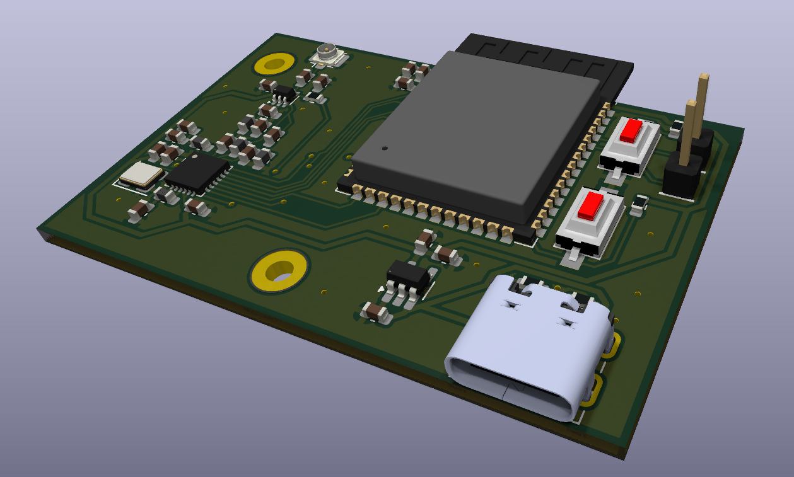
  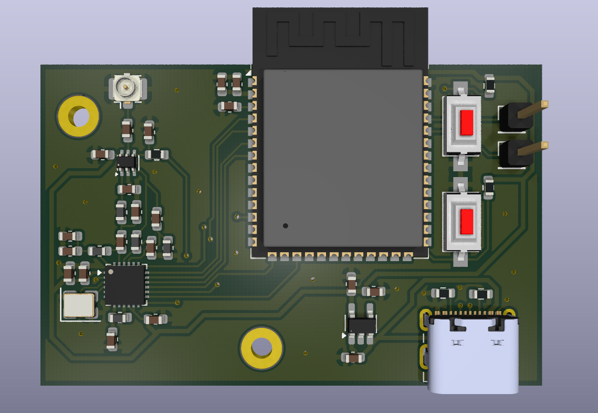

### 3D Board Views

  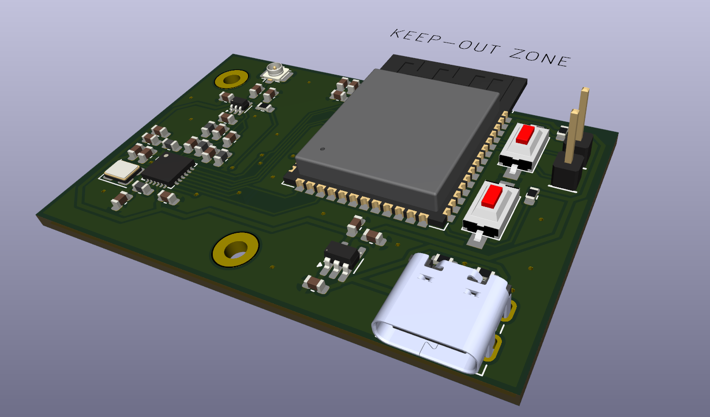
  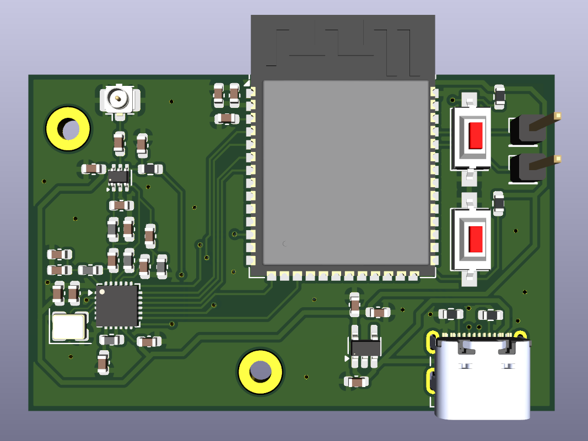

### PCB Layout & Schematic

  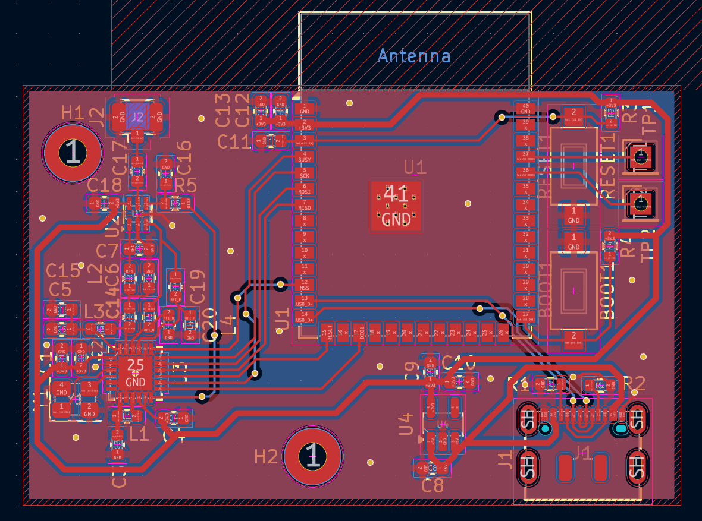
  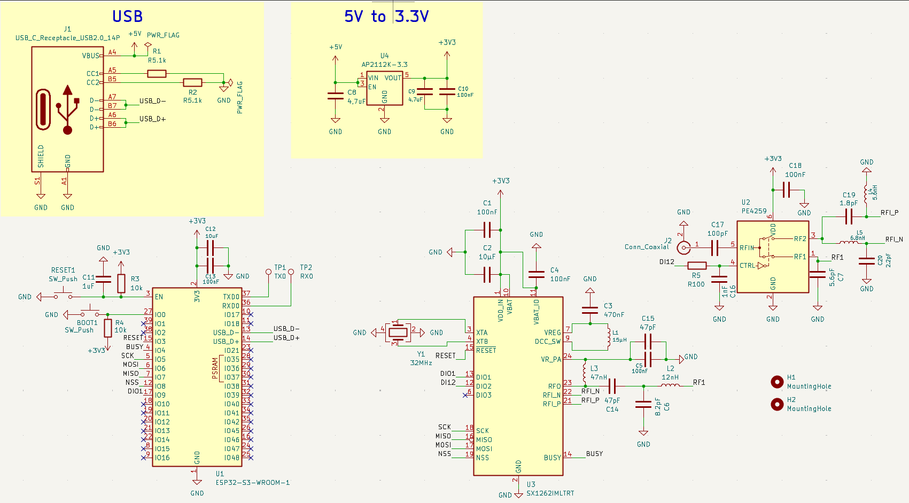

### 3D Enclosure (Fusion 360)

*3D printable case is made in Fusion 360. All CAD and 3D model files are in the [`CAD/`](CAD/) folder.*

  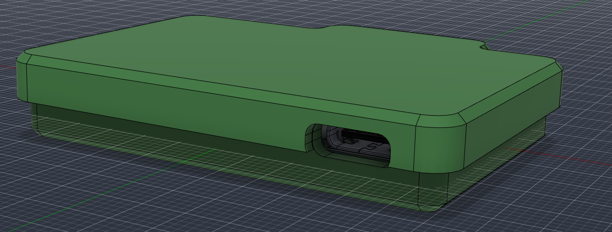

  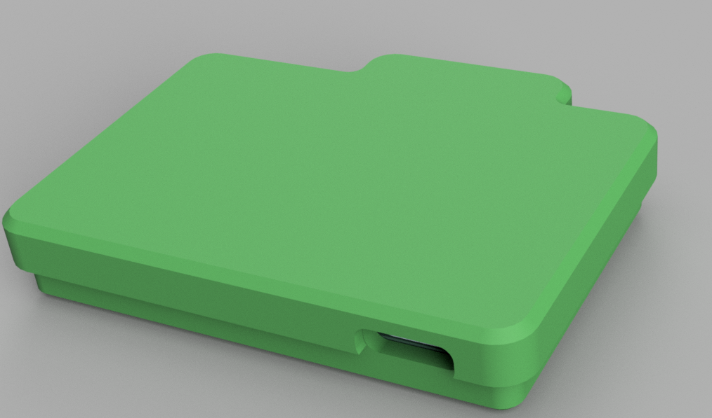
  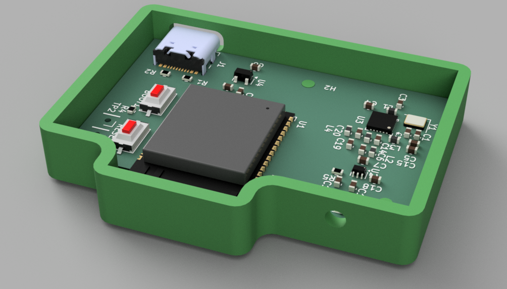

  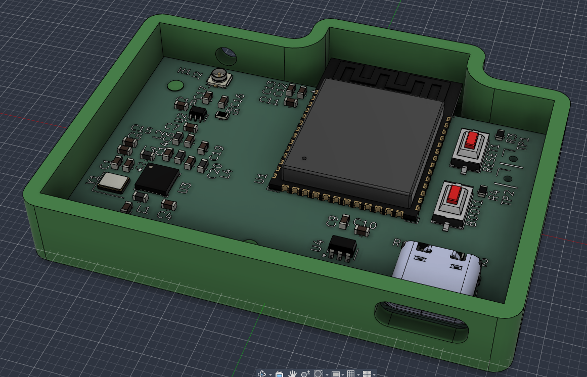
  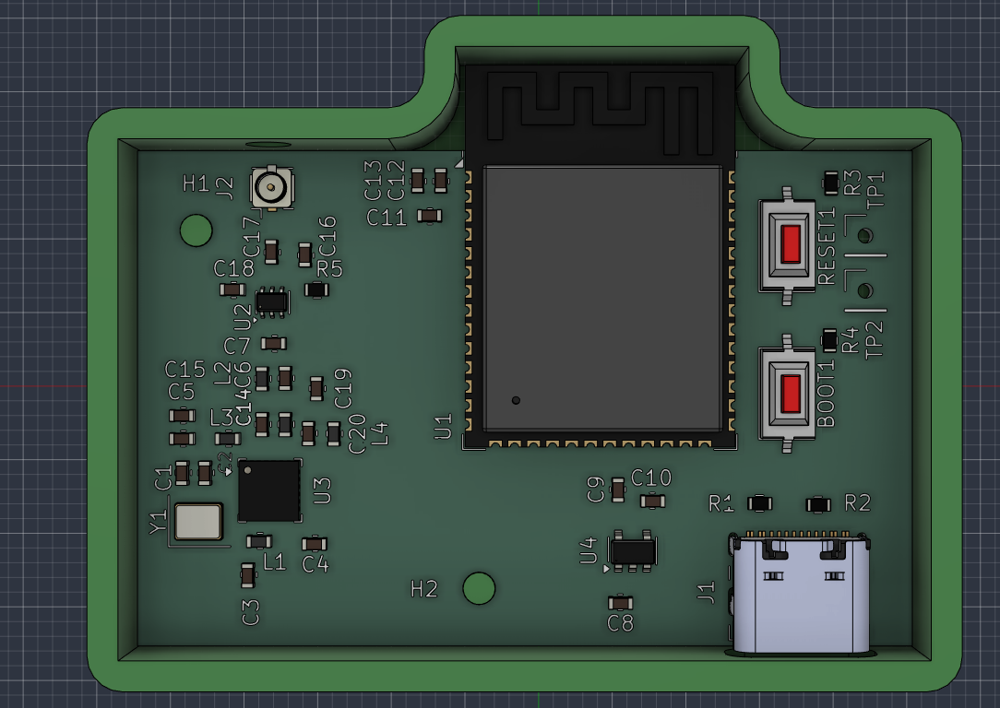

  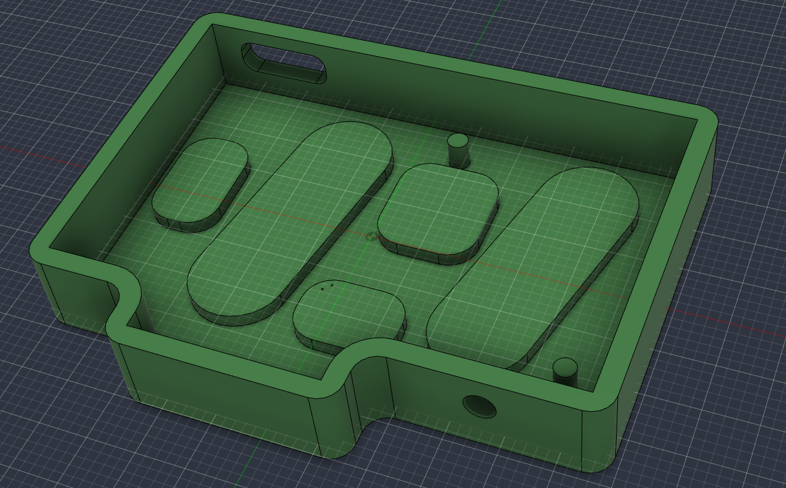

---

## Assembly Guide

### Required Tools & Materials

- Soldering iron
- Solder wire and flux
- Tweezers for placing small SMD components
- 3D Printer (for printing the custom case)

### Assembly Steps

1. **Starts with small schips :**
   - **SX1262** - align carefully, use soldering iron with sharp tip with flux).
   - **PE42359** and **AP2112K-3.3** - soldern one pin, verify if its alligned, and solder remaining pins.
2. **Small passive components:**
   - Solder small resistors and capacitors.
   - Solder inductors and the 32 MHz crystal.
3. **Connectors and Buttons:**
   - **USB-C connector** - Solder the THT tabs first for strength and then solder the pins using flux.
   - **U.FL connector** - Center and solder the RF signal pin and ground tabs.
   - Solder the **BOOT1** and **RESET1** buttons.
4. **ESP32-S3 Module:**
   - Place the **ESP32-S3-WROOM-1** module on its footprint pads.
   - Solder one pad, check alignment and then solder each pin.
5. **Enclosure and antenna :**
   - Plug the flexible flat antenna cable into the U.FL connector.
   - Slide the assembled PCB into case and snap the lid.
   - Stick the flat antenna on the top of the case or where you want it.

---

## BOM

| Reference                     | amount | Value / Component                       | Footprint / Package     | Link                                                                                                                                          | Cost (USD, incl. VAT) |
| ----------------------------- |:------:|:--------------------------------------- |:----------------------- |:--------------------------------------------------------------------------------------------------------------------------------------------- |:---------------------:|
| **BOOT1, RESET1**             | 2      | Tactile Switch (C&K RS-282G05A3-SM RT)  | SMD Button (6.0x3.5mm)  | [Mouser Link](https://cz.mouser.com/c/?q=RS-282G05A3-SM-RT)                                                                                   | $1.92                 |
| **C1, C4, C5, C10, C13, C18** | 6      | 100nF 50V X7R (GCM188R71H104KA57J)      | 0603 SMD                | [Mouser Link](https://cz.mouser.com/c/?q=GCM188R71H104KA57J)                                                                                  | $1.44                 |
| **C2, C12**                   | 2      | 10µF 10V X5R (C1608X5R1A106K080AC)      | 0603 SMD                | [Mouser Link](https://cz.mouser.com/c/?q=C1608X5R1A106K080AC)                                                                                 | $1.10                 |
| **C3**                        | 1      | 470nF 16V X7R (CL10B474KO8NNNC)         | 0603 SMD                | [Mouser Link](https://cz.mouser.com/c/?q=CL10B474KO8NNNC)                                                                                     | $0.13                 |
| **C6**                        | 1      | 8.2pF 50V C0G (CC0603DRNPO9BN8R2)       | 0603 SMD                | [Mouser Link](https://cz.mouser.com/en/ProductDetail/YAGEO/CC0603DRNPO9BN8R2?qs=AgBp2OyFlx9gbUJidsAGNA%3D%3D)                                 | $0.12                 |
| **C7**                        | 1      | 5.6pF 50V C0G (CC0603DRNPO9BN5R6)       | 0603 SMD                | [Mouser Link](https://cz.mouser.com/c/?q=CC0603DRNPO9BN5R6)                                                                                   | $0.12                 |
| **C8, C9**                    | 2      | 4.7µF 16V X5R (C1608X5R1C475K080AC)     | 0603 SMD                | [Mouser Link](https://cz.mouser.com/c/?q=C1608X5R1C475K080AC)                                                                                 | $0.60                 |
| **C11**                       | 1      | 1µF 16V X7R (C0603C105K4RAC)            | 0603 SMD                | [Mouser Link](https://cz.mouser.com/c/?q=C0603C105K4RAC)                                                                                      | $0.17                 |
| **C14, C15**                  | 2      | 47pF 50V C0G (CC0603JPNPO9BN470)        | 0603 SMD                | [Mouser Link](https://cz.mouser.com/en/ProductDetail/YAGEO/CC0603JPNPO9BN470?qs=AgBp2OyFlx%252BcxUrI4zA%252B5Q%3D%3D)                         | $0.24                 |
| **C16**                       | 1      | 1nF 50V X7R (CL10B102KB8NNNC)           | 0603 SMD                | [Mouser Link](https://cz.mouser.com/c/?q=CL10B102KB8NNNC)                                                                                     | $0.12                 |
| **C17**                       | 1      | 100pF 50V C0G (GRM1885C1H101JA01D)      | 0603 SMD                | [Mouser Link](https://cz.mouser.com/en/ProductDetail/Murata-Electronics/GRM1885C1H101JA01D?qs=H3lwsW1hsDt1I4guwPQ00A%3D%3D)                   | $0.13                 |
| **C19**                       | 1      | 1.8pF 50V C0G (CL10C1R8BB8NNNC)         | 0603 SMD                | [Mouser Link](https://cz.mouser.com/c/?q=CL10C1R8BB8NNNC)                                                                                     | $0.12                 |
| **C20**                       | 1      | 2.2pF 50V C0G (GRM1885C1H2R2BA01D)      | 0603 SMD                | [Mouser Link](https://cz.mouser.com/en/ProductDetail/Murata-Electronics/GRM1885C1H2R2BA01D?qs=9yYqngZLNofvaZZkO8y9FQ%3D%3D)                   | $0.17                 |
| **J1**                        | 1      | USB-C Receptacle 16P (DX07S016JA1R1500) | USB-C 16-Pin SMD+THT    | [Mouser Link](https://cz.mouser.com/c/?q=DX07S016JA1R1500)                                                                                    | $2.10                 |
| **J2**                        | 1      | U.FL Coaxial Connector (U.FL-R-SMT-1)   | U.FL SMD Vertical       | [Mouser Link](https://cz.mouser.com/c/?q=U.FL-R-SMT-1)                                                                                        | $1.85                 |
| **L1**                        | 1      | 15µH 150mA (LQM18DH150M70L)             | 0603 SMD                | [Mouser Link](https://cz.mouser.com/c/?q=LQM18DH150M70L)                                                                                      | $0.36                 |
| **L2**                        | 1      | 12nH High-Q RF (LQW18AN12NG00D)         | 0603 SMD                | [Mouser Link](https://cz.mouser.com/c/?q=LQW18AN12NG00D)                                                                                      | $0.16                 |
| **L3**                        | 1      | 47nH High-Q RF (LQW18AN47NG00D)         | 0603 SMD                | [Mouser Link](https://cz.mouser.com/c/?q=LQW18AN47NG00D)                                                                                      | $0.16                 |
| **L4**                        | 1      | 5.6nH High-Q RF (LQW18AN5N6C0ZD)        | 0603 SMD                | [Mouser Link](https://cz.mouser.com/c/?q=LQW18AN5N6C0ZD)                                                                                      | $0.18                 |
| **L5**                        | 1      | 6.8nH High-Q RF (LQW18AS6N8J0ZD)        | 0603 SMD                | [Mouser Link](https://cz.mouser.com/c/?q=LQW18AS6N8J0ZD)                                                                                      | $0.18                 |
| **R1, R2**                    | 2      | 5.1kΩ 1% (RC0603FR-135K1L)              | 0603 SMD                | [Mouser Link](https://cz.mouser.com/en/ProductDetail/YAGEO/RC0603FR-135K1L?qs=3EPPqRBBsNipUNdlRDI61Q%3D%3D)                                   | $0.24                 |
| **R3, R4**                    | 2      | 10kΩ 1% (RC0603FR-0710KL)               | 0603 SMD                | [Mouser Link](https://cz.mouser.com/en/ProductDetail/YAGEO/RC0603FR-0710KL?qs=grNVn54RoB%252B3GtjbJj3wJQ%3D%3D)                               | $0.24                 |
| **R5**                        | 2      | 100Ω 1% (RC0603FR-07100RL)              | 0603 SMD                | [Mouser Link](https://cz.mouser.com/c/?q=RC0603FR-07100RL)                                                                                    | $0.24                 |
| **TP1, TP2**                  | 1      | Pin Header 1x40 (Harwin M20-9994045)    | PinHeader 1x01 (2.54mm) | [Mouser Link](https://cz.mouser.com/c/?q=M20-9994045)                                                                                         | $2.31                 |
| **U1**                        | 1      | ESP32-S3-WROOM-1-N8 (8MB Flash)         | RF Module               | [Mouser Link](https://cz.mouser.com/en/ProductDetail/Espressif-Systems/ESP32-S3-WROOM-1-N8?qs=sGAEpiMZZMu3sxpa5v1qrpuLb1YRQvRH486xd1meH8w%3D) | $6.79                 |
| **U2**                        | 1      | SPDT RF Switch (PE42359SCAA-Z)          | SOT-363 (SC-70-6)       | [Mouser Link](https://cz.mouser.com/c/?q=PE42359SCAA-Z)                                                                                       | $1.18                 |
| **U3**                        | 1      | SX1262IMLTRT LoRa Transceiver           | QFN-24 (4x4mm)          | [Mouser Link](https://cz.mouser.com/c/?q=SX1262IMLTRT)                                                                                        | $10.83                |
| **U4**                        | 1      | AP2112K-3.3TRG1 LDO 3.3V 600mA          | SOT-23-5                | [Mouser Link](https://cz.mouser.com/c/?q=AP2112K-3.3TRG1)                                                                                     | $0.32                 |
| **Y1**                        | 1      | 32MHz Crystal (ABM8-32.000MHZ-10-B1U-T) | SMD 3225-4Pin           | [Mouser Link](https://cz.mouser.com/c/?q=ABM8-32.000MHZ-10-B1U-T)                                                                             | $0.59                 |
| **PCB**                       | 1      |                                         |                         | [JLCPCB](https://jlcpcb.com)                                                                                                                  | ~$10                  |
| **shipping Mouser**           |        |                                         |                         |                                                                                                                                               | $33.80                |
| **Mouser Order**              |        |                                         |                         | [cart.XLS file](file:///D:/!Documents/KiCad/LoRa_Board/Basket_Oct20_1158AM.xls)                                                               | **$67.91**            |
| **Total**                     |        | Cost of everything                      |                         |                                                                                                                                               | **$77.91**            |

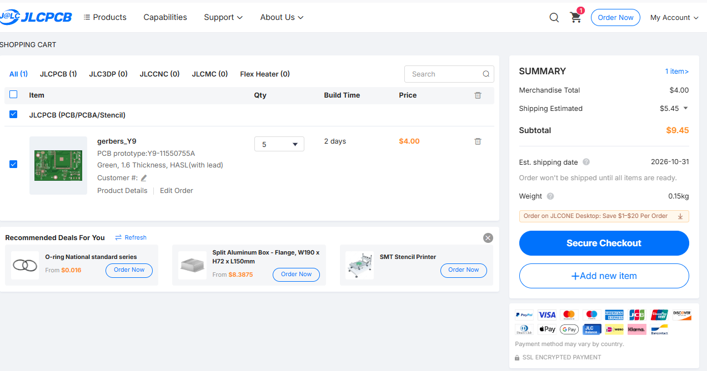

## How to Use

1. **Antenna First:** make sure its a compatible 868 MHz antenna. Never turn the board ON if there is no antenna! 
2. **Power:** Plug a USB-C cable into the board. 
3. **Flashing Firmware & Meshtastic:**
   - Hold down the **BOOT1** button, press and release the **RESET1** button, then release **BOOT1** to enter bootloader mode.
   - Check out the [`Firmware/`](Firmware/) directory for the ready-to-use **Meshtastic** configuration (`variant.h`), pin mappings, and a complete [RadioLib](https://github.com/jgromes/RadioLib) test sketch for PlatformIO/Arduino!
4. **Wireless Communication:**
   - Configure to 868 MHz and try sending/receiving LoRa packets.
   - Perfect for Meshtastic mesh nodes, remote telemetry sensors, and off-grid communication!

---

- Designed by **Šámot** in [Hack Club Forge](https://forge.hackclub.com/projects/3508) project.
